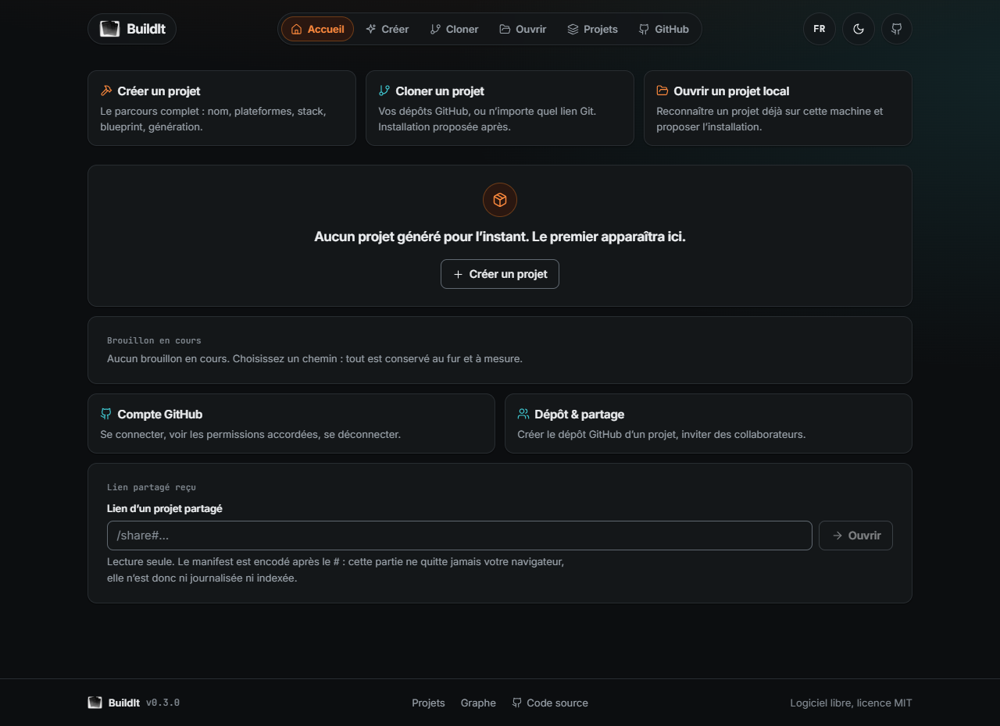
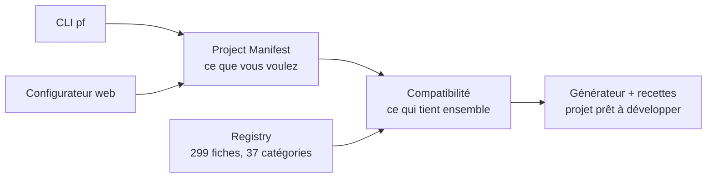

<div align="center">

# BuildIt

**Development Environment Factory** : décrire un projet, choisir ses technologies, obtenir un projet prêt à développer, cohérent, documenté et diagnostiqué.


</div>

> **Pré-alpha, projet en cours.** Le moteur et le configurateur fonctionnent dans ce dépôt, mais rien n'est stabilisé : les interfaces et les formats peuvent changer. Le CLI `pf` n'est pas présenté ici comme publié sur npm ; pour l'utiliser, il faut cloner le dépôt.



## Ce que BuildIt fait

- **Génère un projet** à partir d'un *Project Manifest* (plateformes, architecture, stack, qualité) : code, Docker, configuration d'outils, variables d'environnement, documentation.
- **Vérifie la cohérence** des choix : un moteur de compatibilité refuse ou explique les combinaisons impossibles, avant toute écriture.
- **Offre deux façades au même moteur** : le CLI `pf` et un configurateur web (Next.js, 18 écrans, parcours guidé en 12 étapes). Mêmes choix, même manifest, même projet.
- **Diagnostique** un projet avec `pf doctor` (score de santé sur 100). Sur ce dépôt : 89/100.
- **Gère aussi l'existant** : cloner un dépôt, ouvrir un projet local, créer le dépôt GitHub d'un projet, inviter des collaborateurs, partager un manifest en lecture seule.

## Ce que BuildIt ne fait pas

- Il n'est **pas publié** : ni paquet npm annoncé comme disponible, ni service hébergé garanti. L'installation passe par un clone du dépôt.
- Il **ne couvre pas tout le catalogue** : seules 32 technologies sur 299 sont certifiées (voir [État du projet](#état-du-projet)).
- Le code généré **ne dépend pas de BuildIt** (aucune dépendance runtime, aucun appel réseau vers l'outil), mais il n'est pas une application métier : c'est un socle prêt à développer.
- Il n'envoie aucun code ni prompt à un serveur BuildIt : l'analyse tourne en local, avec votre propre clé API.

## Trois couches



1. **Manifeste** : le *Project Manifest* décrit le projet. Le CLI et le web produisent le même, pour les mêmes choix ([référence](docs/guide/reference-manifest.md)).
2. **Registre** : le catalogue des technologies, une fiche JSON chacune ([référence](docs/guide/reference-registry.md)).
3. **Compatibilité** : le moteur confronte le manifeste au registre et explique chaque refus ([compatibilité](docs/compatibilite.md)).

BuildIt est le produit, **Forge** le moteur, `pf` la commande. Voir [BuildIt et Forge](docs/guide/produit-et-moteur.md).

## Démarrage

Prérequis : **Node ≥ 20.11**, **pnpm ≥ 11**.

```bash
git clone https://github.com/nagoloumdaniel/BuildIt.git
cd BuildIt
pnpm install
pnpm pf --help                                               # les commandes
pnpm pf create mon-projet --preset saas --dir ../mon-projet  # génère, installe, premier commit
pnpm build && pnpm pf web                                    # configurateur sur http://127.0.0.1:4173
```

`pf` s'exécute depuis la racine du dépôt (`pnpm pf <commande>`). Préréglages certifiés : `saas`, `dashboard`, `api`, `fullstack`. Guide détaillé : [démarrage rapide](docs/guide/quickstart.md).

## Stack

TypeScript (strict), Node ≥ 20.11, pnpm + Turborepo, tsdown, Vitest, Biome, zod 4, Next.js 15, React 19, Tailwind CSS 4, lefthook, commitlint, secretlint, changesets. Design « Forge » (orange et cyan acier, Inter et JetBrains Mono), interface FR/EN.

## État du projet

Chiffres comptés dans le dépôt au 2026-10-29 :

| | |
|---|---|
| Registre | **299** fiches, **37** catégories |
| Certifiées / déclarées | **32** / **267** |
| Préréglages certifiés | 4 (SaaS, Dashboard, API, Full-stack) |
| Workspaces | 13 paquets + 2 applications (CLI, web) |
| Fichiers de test | 182 |
| Historique | 118 commits, du 2026-09-23 au 2026-10-14 |

**Certifiée** : la technologie peut être générée et le résultat est éprouvé par le test de fumée (installation, build, démarrage). **Déclarée** : la fiche existe et décrit la technologie (compatibilités, licence, documentation), mais BuildIt ne la génère pas encore de bout en bout. Ne pas lire « déclarée » comme « supportée ».

Le CLI du dépôt est en version 0.5.0 (`@nagoloum/cli`) ; sa publication sur npm n'est pas vérifiée à ce jour. Un déploiement de démonstration du configurateur existe peut-être, mais son état n'est pas garanti.

## Développement

Prérequis : **Node ≥ 20.11**, **pnpm ≥ 11**.

```bash
pnpm install
pnpm ci:local      # lint + typecheck + test + build + scan de secrets
```

Commandes individuelles :

| Commande | Rôle |
|---|---|
| `pnpm lint` | Biome (format + lint) |
| `pnpm lint:fix` | Biome avec corrections appliquées |
| `pnpm typecheck` | TypeScript, mode strict |
| `pnpm test` | Vitest |
| `pnpm build` | tsdown, via Turborepo |
| `pnpm lint:secrets` | secretlint |
| `pnpm pf <commande>` | Le CLI, sur les sources [référence](docs/cli.md) |
| `pnpm pf web` | Le configurateur web, servi en local sur `127.0.0.1` |
| `pnpm test:e2e` | Le parcours des 12 étapes dans un vrai navigateur (Edge/Chrome/Chromium) |

### Intégration continue

La CI GitHub n'est pas disponible pour ce dépôt : **l'intégration continue est locale**, et le hook `pre-push` de lefthook la rend obligatoire.

| Quand | Ce qui tourne |
|---|---|
| chaque push | `pnpm ci:local` lint, typecheck, test, build, scan de secrets |
| push qui touche `generator`, `registry` ou `recipes` | en plus, `pnpm test:smoke` génère de vrais projets, les installe depuis npm, les construit ; avec Docker, va jusqu'à une base réelle et une inscription |
| à la main | `pnpm ci:full` les deux |

Le test de fumée exige Docker (base, Redis, images) et un navigateur (tests Playwright générés, `playwright install chromium` par défaut) : sans eux, il échoue. `PF_SMOKE_SKIP_DOCKER=1` et `PF_SMOKE_SKIP_E2E=1` sautent ces preuves **explicitement** elles apparaissent « skipped » dans le compte et cela se dit dans la PR. `PF_SMOKE_CHROMIUM=<exécutable>` utilise un Chromium déjà installé. Hors-ligne, `LEFTHOOK_EXCLUDE=smoke git push`. Derrière un proxy TLS d'entreprise, `PF_SMOKE_DOCKER_CA=<ca.crt>` permet de construire l'image Docker du test. `.github/workflows/ci.yml` est gardé dormant (déclenchement manuel), prêt à resservir.

### Structure

```
tooling/    configurations partagées (TypeScript, …)
packages/   moteur manifest, registry, compatibility, generator, presets…
apps/cli/   le CLI pf
docs/       cahier des charges, roadmap, specs, plans
```

---

## Documentation

- [Guide](docs/README.md) le produit tel qu'il est :
  - [Démarrage rapide](docs/guide/quickstart.md) · [Concepts](docs/guide/concepts.md) · [BuildIt et Forge](docs/guide/produit-et-moteur.md)
  - [No-lock-in](docs/guide/no-lock-in.md) · [Confidentialité](docs/guide/confidentialite.md)
  - [Référence du manifest](docs/guide/reference-manifest.md) · [Référence du registry](docs/guide/reference-registry.md) · [Commandes](docs/guide/commandes.md)
- [Cahier des charges](docs/cahier-des-charges.md) cadrage produit et technique complet
- [Roadmap](docs/roadmap.md) 0 → beta publique, phase par phase
- [CLI `pf`](docs/cli.md) référence des commandes
- [`llms.txt`](docs/llms.txt) index court et factuel pour les moteurs
- [Contribuer](CONTRIBUTING.md)

## Licence

[MIT](LICENSE) © 2026 Daniel Nagoloum Talla.

## Contribuer

Les contributions externes ne sont pas encore ouvertes, mais les conventions sont posées : [CONTRIBUTING.md](CONTRIBUTING.md), [code de conduite](CODE_OF_CONDUCT.md), [politique de sécurité](SECURITY.md). Les issues et pull requests disposent de modèles.

## Transparence sur l'IA

Ce projet a été développé avec l'assistance d'outils d'IA (Claude). Sur 118 commits : 92 sont d'auteurs humains, 26 ont l'auteur « Claude », et 82 portent une mention `Co-Authored-By`. Le code est relu, testé et soumis aux mêmes garde-fous locaux que tout le reste (lint, typecheck, tests, scan de secrets).

